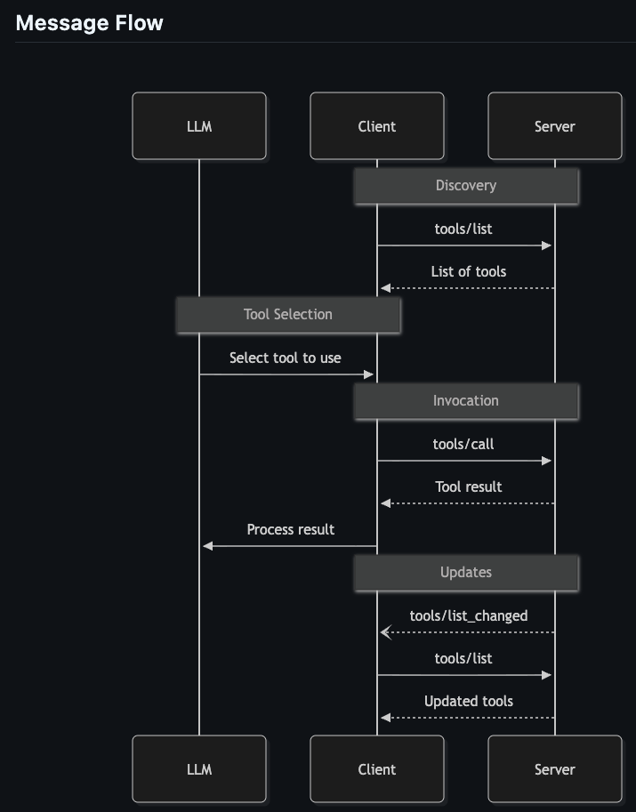

# AI ASSISTANT MCP
- LLM takes care of the orchestration of tool calls flow by checking the available tools

- Tools are best for actions and dynamic queries
- A prompt can guide the model to use tools in a particular way, but it doesn’t replace the tools themselves.
- Resources are best used for retrieving stable artifacts such as documents, configuration data, or knowledge assets
- Completions provide suggestions and autocomplete
  - client can call completions/list to see available list 
  - client can also provide partial values  to completions/complete and the server returns suggested completions
  - This ultimately guide clients to construct valid commands or tools parameters
  - best used in Coding assistants, IDEs, CLI tools, Developer platforms

- we would potentially connect the ai assistant mcp as resource server then in turn it would call the mcp servers with
- client credentials (machine to machine connection)


- Message Flow
- mcp Github details: https://github.com/modelcontextprotocol/modelcontextprotocol/blob/main/docs/specification/2025-03-26/server/tools.mdx
- 

- on tool list change
  - org.springframework.ai.mcp.SyncMcpToolCallbackProvider  handles the invalidation of the cache and refreshed the 
  - updated tools/list
  - This happens when the server sends the Tools Changed Event 

- MCP CLIENT SECURITY
  - supports sync only
```yaml
spring:
  ai:
    mcp:
      client:
        type: SYNC
```

- Authorization Flow - https://docs.spring.io/spring-ai/reference/api/mcp/mcp-security.html#_authorization_flows
  - Authorization Code Flow - For user-level permissions when every MCP request is made within the context of a user request
  - Client Credentials Flow - For machine-to-machine use cases where no human is in the loop 
  - Hybrid Flow - Combines both flows for scenarios where some operations (like initialize or tools/list) happen without a user present, but tool calls require user-level permissions

- Our scenario
  - The best would have been client credentials since our ai-assistant-mcp calls the mcp server directly
    - note: the token would have to carry client credentials permissions : i.e SYSTEM_ACCESS
  - however, the ai-assistant-mcp needs to be configured as a resource server with an audience (assistant_mcp_client)
    - that way it's part of a user's resource
  
- Scenario Flow
  1. call ai-assistant-mcp (resource server)
    - hence the audience must carry assistant_mcp_client
  2. next the assistant sees it needs to call mcp server tools (using client credentials)
    - hence the audience must carry the mcp server audiences in this case: http://localhost:8084/mcp and http://localhost:8082/mcp